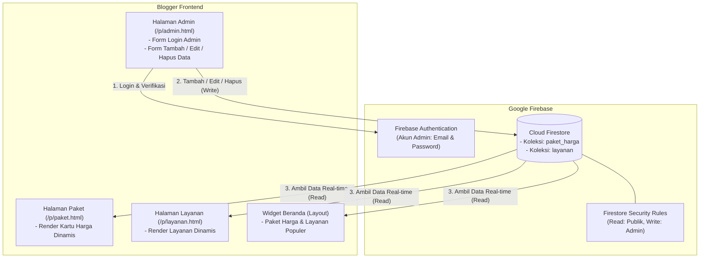

# Alur Pengerjaan: Integrasi Firebase & Halaman Admin ke Blogger (BanyuWeb)

Dokumen ini memuat panduan komprehensif langkah demi langkah (*roadmap & step-by-step implementation*) untuk mengkoneksikan website Blogger **BanyuWeb** ke database **Google Firebase (Cloud Firestore & Authentication)**, serta membangun halaman admin untuk mengelola layanan dan paket harga secara dinamis.

---

## 1. Gambaran Arsitektur Sistem



---

## 2. Rincian Tahapan Pengerjaan

### Tahap 1: Setup Google Firebase (Gratis / Spark Plan)
*Perkiraan Waktu: 15 - 20 Menit*

1. **Buat Project Firebase**:
   - Buka [Firebase Console](https://console.firebase.google.com/).
   - Klik **Add Project**, beri nama misal `banyuweb-umkm`.
   - Google Analytics bersifat opsional (bisa diaktifkan atau dinonaktifkan).
2. **Setup Authentication**:
   - Masuk ke menu **Build > Authentication** > klik **Get Started**.
   - Pilih tab **Sign-in method**, aktifkan **Email/Password**.
   - Masuk ke tab **Users**, klik **Add user** untuk membuat akun admin (masukkan email dan password rahasia Anda).
3. **Setup Database (Cloud Firestore)**:
   - Masuk ke menu **Build > Firestore Database** > klik **Create Database**.
   - Pilih lokasi database terdekat (misal `asia-southeast2` Jakarta atau `asia-southeast1` Singapura).
   - Pilih mode awal: **Start in production mode**.
4. **Atur Firestore Security Rules**:
   - Buka tab **Rules** pada Firestore, ganti isinya menjadi:
     ```javascript
     rules_version = '2';
     service cloud.firestore {
       match /databases/{database}/documents {
         // Data paket harga & layanan: publik bisa membaca, hanya admin login yang bisa mengubah
         match /paket_harga/{document=**} {
           allow read: if true;
           allow write: if request.auth != null;
         }
         match /layanan/{document=**} {
           allow read: if true;
           allow write: if request.auth != null;
         }
       }
     }
     ```
   - Klik **Publish**.
5. **Dapatkan Firebase Config (Kredensial Web)**:
   - Masuk ke **Project Settings** (ikon gerigi di kiri atas).
   - Scroll ke bawah ke bagian **Your apps**, klik ikon Web (`</>`).
   - Daftarkan nama aplikasi (misal `BanyuWeb Portal`).
   - Simpan kode konfigurasi `firebaseConfig`:
     ```javascript
     const firebaseConfig = {
       apiKey: "AIzaSy...",
       authDomain: "banyuweb-umkm.firebaseapp.com",
       projectId: "banyuweb-umkm",
       storageBucket: "banyuweb-umkm.appspot.com",
       messagingSenderId: "...",
       appId: "..."
     };
     ```

---

### Tahap 2: Perancangan Struktur Data (Skema Database)

Ada 2 koleksi utama yang akan disimpan di Firestore:

#### 1. Koleksi: `paket_harga`
Setiap dokumen mewakili satu paket di halaman `/p/paket.html` dan widget Beranda:
| Field | Tipe Data | Keterangan / Contoh |
|---|---|---|
| `nama` | string | `"Paket Bisnis"` |
| `harga` | string | `"Rp 2,5 jt"` |
| `subtext` | string | `"mulai dari"` / `"sekali bayar"` |
| `deskripsi` | string | `"Paling pas untuk usaha yang ingin dipercaya & ramai dicari."` |
| `fitur` | array of string | `["Website hingga 6 halaman", "SEO lokal Banyuwangi", "Setup Google Bisnis"]` |
| `fiturMinus` | array of string | `["Opsi fitur yang belum termasuk"]` |
| `isPopular` | boolean | `true` (jika ingin diberi badge "PALING DIMINATI") |
| `urutan` | number | `1`, `2`, `3` (menentukan posisi urutan tampil) |
| `textWa` | string | Pesan template saat tombol WhatsApp diklik |

#### 2. Koleksi: `layanan`
Setiap dokumen mewakili satu jenis layanan di halaman `/p/layanan.html` dan widget Beranda:
| Field | Tipe Data | Keterangan / Contoh |
|---|---|---|
| `nama` | string | `"Website Profil Usaha"` |
| `slugId` | string | `"profil-usaha"` (untuk anchor link `#profil-usaha`) |
| `lead` | string | `"Etalase digital usaha Anda: siapa Anda, apa yang dijual..."` |
| `icon` | string | `"bi-window-sidebar"` (kelas Bootstrap Icon) |
| `fitur` | array of string | `["Beranda, Tentang, Layanan, Galeri", "Peta Google Maps"]` |
| `tags` | array of string | `["Homestay", "Bengkel", "Laundry", "Salon"]` |
| `urutan` | number | `1`, `2`, `3`, `4` |

---

### Tahap 3: Pembuatan Halaman Admin Dashboard (`admin.html`)

Halaman admin dibuat dalam satu file mandiri (`admin.html`) yang nantinya di-upload ke Blogger sebagai **Laman Baru** dengan URL `/p/admin.html`.

#### Fitur-Fitur Halaman Admin:
1. **Layar Login (Auth Gate)**:
   - Jika admin belum login, hanya form email dan password yang muncul.
   - Menghubungkan ke `firebase.auth().signInWithEmailAndPassword(email, password)`.
2. **Manajemen Paket Harga (CRUD)**:
   - **Tabel Daftar Paket**: Menampilkan nama paket, harga, badge populer, dan tombol aksi (Edit & Hapus).
   - **Form Input / Edit**:
     - Input Nama Paket, Harga, Subtext, Deskripsi.
     - Input Fitur (input multi-baris atau tag).
     - Checkbox "Tandai sebagai Paket Paling Diminati".
     - Urutan tampil.
3. **Manajemen Layanan (CRUD)**:
   - Menampilkan daftar layanan aktif.
   - Form tambah / edit rincian layanan, icon Bootstrap, dan tags kategori.
4. **Keamanan Halaman**:
   - Tombol **Logout** yang membersihkan sesi.
   - Laman ini **tidak dimasukkan** ke menu navigasi Navbar Blogger.

---

### Tahap 4: Modifikasi Halaman Publik Blogger

#### 1. File `harga.html` (Laman `/p/paket.html`)
- Mengganti daftar kartu harga hardcoded dengan elemen kontainer:
  ```html
  <div id="daftar-paket-harga" class="bw-grid g3" style="align-items:stretch">
    <!-- Konten otomatis di-render oleh script Firebase -->
  </div>
  ```
- Menambahkan skrip pembaca Firestore yang me-looping koleksi `paket_harga` dan mencetak HTML dengan class CSS bawaan BanyuWeb (`bw-card bw-price`, `bw-amt`, `bw-ul`, dll.).

#### 2. File `layanan.html` (Laman `/p/layanan.html`)
- Menyediakan kontainer dinamis untuk memuat blok layanan.
- Mengambil data dari koleksi `layanan` di Firestore dan merender sesuai grid layout BanyuWeb.

---

### Tahap 5: Sinkronisasi ke Widget Beranda (Homepage)

Beranda Blogger memuat cuplikan harga dan layanan melalui widget layout:
- `layout/Landing-Page-Home/Beranda - Paket Harga.txt`
- `layout/Landing-Page-Home/Beranda - Layanan.txt`

**Strategi:**
1. Widget Beranda disesuaikan agar membaca langsung dari Firestore atau menampilkan data default yang otomatis ter-update jika data di database berubah.
2. Dengan begitu, sekali Anda mengganti harga di Admin Dashboard, **halaman Beranda dan halaman Paket Harga langsung berubah secara bersamaan**.

---

### Tahap 6: Pengujian & Verifikasi (Testing & QA)

| Skenario Pengujian | Hasil yang Diharapkan |
|---|---|
| Login Admin dengan password salah | Muncul pesan error, form dashboard tidak terbuka |
| Login Admin dengan akun terdaftar | Berhasil masuk ke dashboard pengelola |
| Tambah paket harga baru di admin | Paket baru langsung muncul di `/p/paket.html` |
| Ubah nominal harga paket yang sudah ada | Harga di halaman paket langsung ter-update |
| Centang status "Paling Diminati" | Kartu paket mendapatkan highlight warna oranye & badge |
| Hapus salah satu paket | Paket hilang dari tampilan publik |
| Akses publik tanpa login mencoba menulis data | Ditolak oleh Firestore Security Rules (Permission Denied) |
| Uji tampilan di Smartphone (Mobile Responsive) | Kartu dan form admin tetap rapi di layar kecil |

---

## 3. Checklist Eksekusi Mandiri

- [ ] **Langkah 1**: Buat proyek Firebase & aktifkan Auth (Email/Password) serta Firestore.
- [ ] **Langkah 2**: Terapkan Firestore Security Rules untuk proteksi akses data.
- [ ] **Langkah 3**: Simpan kredensial `firebaseConfig`.
- [ ] **Langkah 4**: Buat file `admin.html` lalu pasang di Laman Blogger (`/p/admin.html`).
- [ ] **Langkah 5**: Sesuaikan `harga.html` agar menarik data dari Firestore.
- [ ] **Langkah 6**: Sesuaikan `layanan.html` agar menarik data dari Firestore.
- [ ] **Langkah 7**: Update widget tata letak Beranda di Blogger Layout.
- [ ] **Langkah 8**: Lakukan uji coba input dan perubahan data.

---

*Catatan Keamanan: `apiKey` pada Firebase Web SDK aman diletakkan di frontend HTML karena keamanan data sepenuhnya dikendalikan oleh Firestore Security Rules yang telah dikonfigurasi di Tahap 1.*

