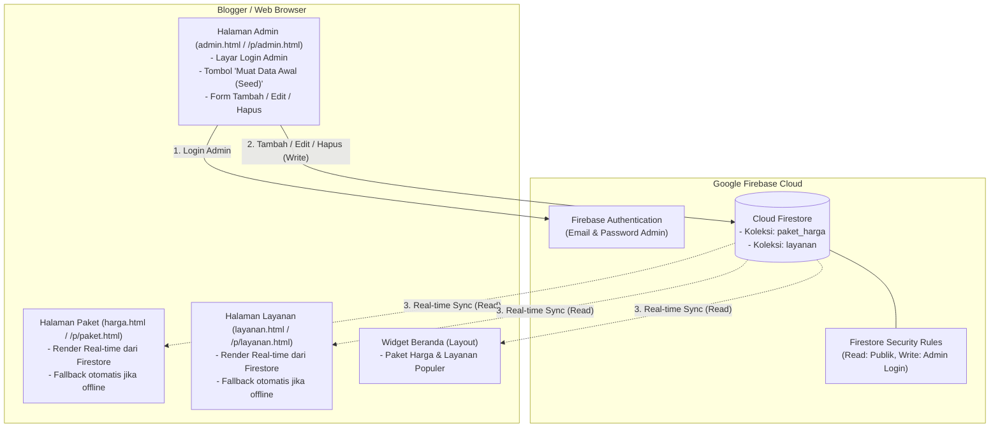

# Panduan Lengkap: Integrasi Firebase & Halaman Admin ke Blogger (Jasa Buat Website Batu)

Dokumen ini memuat panduan lengkap dari awal hingga akhir (*step-by-step tutorial*) untuk menghubungkan website Blogger **Jasa Buat Website Batu (jasabuatwebsitebatu)** ke database **Google Firebase (Cloud Firestore & Authentication)**, serta cara mengoperasikan halaman admin untuk mengelola layanan dan paket harga.

---

## 1. Arsitektur & Cara Kerja Sistem



---

## 2. Alur Pembuatan & Setup Firebase (Langkah Demi Langkah)

### Langkah 1: Buat Proyek Firebase Baru
1. Kunjungi **[Firebase Console](https://console.firebase.google.com/)** dan login dengan akun Google Anda.
2. Klik **Add project** (Tambah proyek).
3. Beri nama proyek, misalnya: `jasabuatwebsitebatu`.
4. Pada bagian *Google Analytics*, Anda bisa memilih menonaktifkannya (atau aktifkan jika ingin analitik lanjutan).
5. Klik **Create project** dan tunggu proses pembuatan selesai (sekitar 10–20 detik).

---

### Langkah 2: Aktifkan Login Admin (Authentication)
1. Di sidebar kiri Firebase Console, klik menu **Build > Authentication**.
2. Klik tombol **Get Started**.
3. Di tab **Sign-in method**, pilih penyedia **Email/Password**.
4. Aktifkan toggle **Email/Password** (biarkan *Email link (passwordless sign-in)* nonaktif), lalu klik **Save**.
5. Pindah ke tab **Users**, lalu klik **Add user**:
   - Masukkan **Email Admin** (misal: `admin@jasabuatwebsitebatu.com`).
   - Masukkan **Password Admin** yang aman (minimal 6 karakter).
   - Klik **Add user**. *(Kredensial inilah yang nantinya digunakan untuk login di Halaman Admin)*.

---

### Langkah 3: Aktifkan Database (Cloud Firestore)
1. Di sidebar kiri, klik menu **Build > Firestore Database**.
2. Klik tombol **Create database**.
3. **Database location**: Pilih lokasi server terdekat dengan audiens Indonesia:
   - Rekomendasi: `asia-southeast2` (Jakarta) atau `asia-southeast1` (Singapura).
4. **Secure rules for Cloud Firestore**:
   - Pilih **Start in production mode** lalu klik **Next** > **Enable**.
5. Tunggu database siap dibuat.

---

### Langkah 4: Pasang Firestore Security Rules (Sangat Penting!)
Keamanan data diatur melalui Security Rules agar pengunjung umum hanya bisa **membaca** data harga/layanan, dan **hanya Anda (admin yang sudah login)** yang berhak menambah, mengubah, atau menghapus data:

1. Di halaman Cloud Firestore, klik tab **Rules** (Aturan).
2. Ganti seluruh isi aturan dengan kode berikut:
   ```javascript
   rules_version = '2';
   service cloud.firestore {
     match /databases/{database}/documents {
       // Siapa saja boleh melihat paket harga dan layanan
       // Hanya akun yang sudah login melalui Firebase Auth yang boleh menulis/mengedit
       match /paket_harga/{document=**} {
         allow read: if true;
         allow write: if request.auth != null;
       }
       match /layanan/{document=**} {
         allow read: if true;
         allow write: if request.auth != null;
       }
     }
   }
   ```
3. Klik tombol **Publish** (Terbitkan).

---

### Langkah 5: Daftarkan Aplikasi Web & Ambil Konfigurasi
1. Klik ikon gerigi **Project Settings** (di samping menu *Project Overview* di kiri atas).
2. Scroll ke bagian bawah ke bagian **Your apps**.
3. Klik ikon Web (`</>`).
4. Masukkan nama aplikasi (misal `Jasa Buat Website Batu`), jangan centang Firebase Hosting untuk saat ini, lalu klik **Register app**.
5. Salin blok objek `firebaseConfig`:
   ```javascript
   const firebaseConfig = {
     apiKey: "AIzaSy...",
     authDomain: "jasabuatwebsitebatu.firebaseapp.com",
     projectId: "jasabuatwebsitebatu",
     storageBucket: "jasabuatwebsitebatu.appspot.com",
     messagingSenderId: "1234567890",
     appId: "1:1234567890:web:abcdef..."
   };
   ```

---

## 3. Cara Menghubungkan Konfigurasi ke Website

Ada 2 cara yang sangat mudah untuk memasukkan konfigurasi Firebase:

### Cara A: Melalui Menu Pengaturan di Halaman Admin (Paling Praktis)
1. Buka file `admin.html` langsung di browser Anda (cukup klik ganda file `admin.html`).
2. Masuk ke tab **Pengaturan Firebase**.
3. Salin nilai `apiKey`, `projectId`, `authDomain`, dll. ke dalam kolom form yang disediakan.
4. Klik **Simpan Konfigurasi**. Pengaturan akan otomatis tersimpan di browser Anda!

### Cara B: Mengisi File `firebase-config.js`
Buka file `firebase-config.js` di editor teks, lalu ganti nilai `BW_DEFAULT_CONFIG` dengan konfigurasi asli dari Firebase Console Anda:
```javascript
const BW_DEFAULT_CONFIG = {
  apiKey: "AIzaSy... (API Key Asli)",
  authDomain: "jasabuatwebsitebatu.firebaseapp.com",
  projectId: "jasabuatwebsitebatu",
  storageBucket: "jasabuatwebsitebatu.appspot.com",
  messagingSenderId: "...",
  appId: "..."
};
```

---

## 4. Cara Menggunakan Halaman Admin (`admin.html`)

Halaman Admin dirancang dengan tampilan elegan yang sama persis dengan tema Jasa Buat Website Batu (`Plus Jakarta Sans`, `Poppins`, Bootstrap Icons, palet oranye & navy):

### 1. Membuka & Login
* Buka `admin.html` di browser Anda atau kunjungi halaman Blogger Anda di `/p/admin.html`.
* Masukkan email dan password admin yang telah dibuat pada **Langkah 2**.
* Klik **Masuk ke Dashboard**.

### 2. Mengisi Data Awal dengan 1 Klik ("Seed Data")
* Saat pertama kali database Firestore dibuat, koleksi `paket_harga` dan `layanan` masih kosong.
* Cukup klik tombol **"Muat Data Awal (Seed)"** di kanan atas dashboard.
* Sistem akan secara otomatis memasukkan:
  - **3 Paket Harga Bawaan**: *Rintisan*, *Bisnis* (badge Paling Diminati), dan *Toko & Katalog*.
  - **4 Layanan Bawaan**: *Website Profil Usaha*, *Katalog & Toko*, *Landing Page*, dan *Redesain Website Lama*.

### 3. Mengelola Paket Harga
* **Tambah Paket Baru**: Klik tombol **Tambah Paket**, isi nama paket, nominal harga (misal `Rp 3 jt`), keterangan (`mulai dari`), deskripsi singkat, rincian fitur (tulis 1 baris per fitur), dan centang pilihan *Tandai PALING DIMINATI* jika ingin di-highlight oranye.
* **Edit Paket**: Klik tombol **Edit** pada kartu paket yang ingin diubah harganya.
* **Hapus Paket**: Klik tombol ikon tempat sampah berwarna merah.

### 4. Mengelola Layanan
* Pindah ke tab **Layanan UMKM**.
* Anda dapat menambah layanan baru, mengatur icon Bootstrap, mengubah deskripsi, mengedit fitur, dan memasukkan contoh usaha/kategori tag (misal: *Homestay, Bengkel, Kuliner*).

---

## 5. Cara Memasang ke Blogger

### 1. Pasang Halaman Admin (`/p/admin.html`)
1. Buka dashboard **Blogger > Laman**.
2. Klik **Laman Baru**.
3. Beri judul laman: `Admin`.
4. Ubah mode editor ke **Tampilan HTML** (klik ikon pensil di kiri atas lalu pilih ikon `<>` HTML).
5. Salin seluruh isi file `admin.html` dan tempelkan ke editor Blogger.
6. Pada setelan laman di sebelah kanan:
   - Komentar pembaca: **Jangan izinkan, sembunyikan yang ada**.
7. Klik **Publikasikan**.
8. URL yang terbentuk adalah: `https://namabloganda.blogspot.com/p/admin.html`.
   *(Catatan: Jangan tambahkan link halaman ini ke menu navbar publik agar aman dari jangkauan pengunjung biasa).*

### 2. Perbarui Halaman Paket & Harga (`/p/paket.html`)
1. Buka **Blogger > Laman**, edit laman **Paket**.
2. Ubah ke mode **Tampilan HTML**.
3. Salin seluruh isi file `harga.html` yang telah diperbarui dan simpan.
4. Sekarang halaman paket harga sudah live terhubung ke Firebase!

### 3. Perbarui Halaman Layanan (`/p/layanan.html`)
1. Buka **Blogger > Laman**, edit laman **Layanan**.
2. Ubah ke mode **Tampilan HTML**.
3. Salin seluruh isi file `layanan.html` yang telah diperbarui dan simpan.

### 4. Perbarui Widget Beranda (Tata Letak)
1. Buka **Blogger > Tata Letak**.
2. Edit widget HTML/JavaScript untuk **Paket Harga**, perbarui isinya dari file `layout/Landing-Page-Home/Beranda - Paket Harga.txt`.
3. Edit widget HTML/JavaScript untuk **Layanan**, perbarui isinya dari file `layout/Landing-Page-Home/Beranda - Layanan.txt`.
4. Simpan setelan tata letak.

---

## 6. Fitur Keunggulan & Keamanan

1. **Fallback Otomatis (Zero Downtime)**:
   Jika koneksi internet pengunjung sedang lambat atau Firebase sedang loading, halaman tidak akan kosong. Halaman otomatis menampilkan susunan harga bawaan sampai data real-time selesai ditarik.
2. **Real-time Sync**:
   Menggunakan `onSnapshot` Firestore, perubahan harga di halaman Admin langsung tampil di layar pengunjung tanpa perlu me-refresh halaman!
3. **Biaya Rp 0 (Free Spark Plan)**:
   Kapasitas gratis Firebase menyediakan:
   - 50.000 pembacaan database per hari.
   - 20.000 penulisan data per hari.
   - 1 GB penyimpanan data.
   Untuk website UMKM, kuota ini **100% gratis selamanya**.
4. **Proteksi Hak Akses**:
   Pengunjung biasa tidak dapat memodifikasi database karena setiap perintah tulis diverifikasi oleh *Firestore Security Rules* melalui token autentikasi admin.
